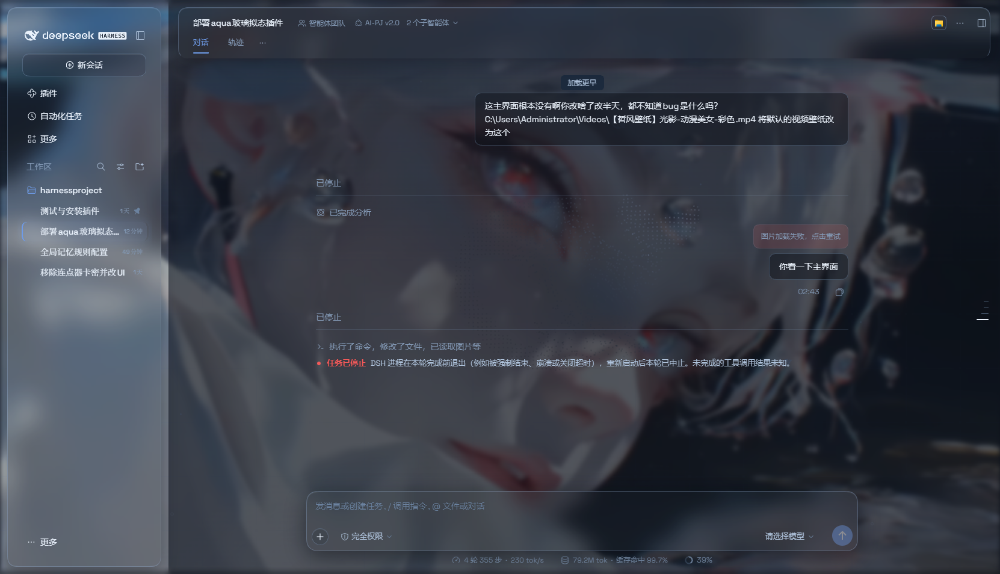
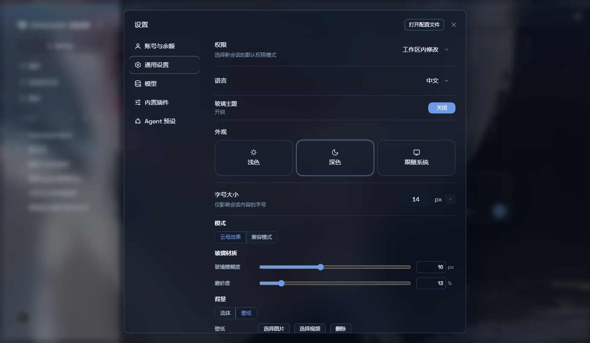

# Aqua — glassmorphism skin for DeepSeek Harness (dsh 0.2.x)

A port of the **Aqua** transparent/glass theme to the current DeepSeek Harness
runtime (0.2.2-rc.1), with the "global glass" layer folded into the plugin, a
working master switch, a local **video wallpaper** served by the plugin itself,
and the animation loops tuned for low CPU.




Upstream work this builds on:

| Project | What it contributed |
| --- | --- |
| [WYH66666666/DSH-Transparent-UI-Plugin](https://github.com/WYH66666666/DSH-Transparent-UI-Plugin) | the original Aqua skin, its bundle layout and settings rows |
| [colm20060530/harness-desktop](https://github.com/colm20060530/harness-desktop) | the "global glass" override sheet, tuned defaults, the `key:` slot fix |

This fork exists because the upstream 1.3.0 bundle targets dsh 0.1.x / rc.6 and
does not run on 0.2.x as shipped.

> Repo: <https://github.com/colm20060530/dsh-aqua-plugin> · built for the desktop app in
> <https://github.com/colm20060530/harness-desktop>.

## What this fork changes

**Compatibility with dsh 0.2.x**

| Upstream | 0.2.x reality | Fix |
| --- | --- | --- |
| `require("@deepseek-ai/dsh-client-runtime/client")` | package is gone; the store lives in the browser seed `@deepseek-ai/dsh-client-store` | require the seed module |
| `IconCheckOutline16` | icon set renamed | `IconCheckOutline*` fallback chain |
| registers a `settings.plugin.item` card | that slot no longer exists | guarded registration |
| `peerDependencies ^0.1.0-rc.5` | compat gate silently disables the row | `engines.dsh: ^0.2.2-rc.1` |

**One master switch.** Settings → 通用设置 → the row above 外观 toggles the whole
skin, and `Ctrl+Alt+A` does the same from anywhere. The flag is the plugin's own
`localStorage["dsh.ui-aqua.enabled"]`.

**Local video wallpaper.** The host half (`lib/index.js`, an otherwise empty
`apply`) registers `/aqua/wallpaper.mp4` and streams a file from disk with byte
ranges; the browser half points its default wallpaper at that route. Point it
elsewhere through the loader row:

```yaml
- insert:
    - id: ui-aqua
      name: '@deepseek-ai/dsh-client-ui-aqua'
      config:
        video: 'C:/path/to/your-wallpaper.mp4'
```

**Global glass.** `desktop/resources/aqua-overrides.css` from harness-desktop is
inlined into the bundle and injected as a fifth `<style data-plugin-css>`; it is
keyed on `html[data-dsh-aqua]`, so turning the skin off retracts all of it —
including the override that makes the desktop shell's opaque
`[data-windows-titlebar] .centerCol` translucent.

**Performance**

- the WebGL fluid canvas is capped at 1× DPR and skipped entirely while hidden
  (wallpaper mode hides it with `display:none`, so the shader used to run
  invisibly);
- every animation loop (fluid, whale, mesh) idles while `document.hidden`;
- the wallpaper `<video>` uses `preload="metadata"` and pauses when the window
  is hidden, so a 4K source stops decoding in the background.

## Install

Requires a dsh installation with a desktop profile (`~/.dsh/profiles/desktop`).

```powershell
pwsh -File scripts/install.ps1 -Video 'C:/path/to/wallpaper.mp4'
```

The script copies the package to `~/.dsh/plugins/@deepseek-ai/dsh-client-ui-aqua`,
links it into the profile's `node_modules`, records the dependency, and rewrites
the `ui-aqua` row in the profile's `cordis.patch.yml` (backups next to every file
it touches). `-Uninstall` removes the row and the link.

Manual install is the same three steps:

1. put the package on disk and link it as `@deepseek-ai/dsh-client-ui-aqua`
   inside the profile's `node_modules`;
2. add the `insert` row above to `cordis.patch.yml`;
3. reload the Web UI (desktop builds only load the bundle at start-up, so
   **restart the app**).

## CSS variable / setting reference

| Setting | Default | Notes |
| --- | --- | --- |
| 模式 | 云母效果 | mica = floating glass cards; 兼容模式 keeps the stock layout |
| 玻璃模糊度 / 磨砂度 | 16 px / 13 % | the overrides are calibrated for this pair |
| 背景 | 壁纸 | 流体 = animated shader backdrop, 壁纸 = image/video |
| 壁纸蒙层 / 模糊 | 70 % / 10 px | image wallpaper only |
| 视频亮度 / 模糊 | 50 / 4 px | video wallpaper only |

## Build

`build/build-aqua.mjs` patches an upstream Aqua bundle into this one. It needs
the upstream `lib/client.js` and `aqua-overrides.css`; paths default to the
layout of the authoring machine and can be overridden:

```powershell
$env:AQUA_SRC = 'C:/path/to/upstream/dsh-client-ui-aqua'
$env:AQUA_OVERRIDES = 'C:/path/to/aqua-overrides.css'
node build/build-aqua.mjs
```

The script is intentionally anchor-based — every upstream edit must match once,
and the build fails loudly otherwise.

## Licence

MIT. Upstream skin and override sheet are MIT; see `LICENSE` for attribution.
